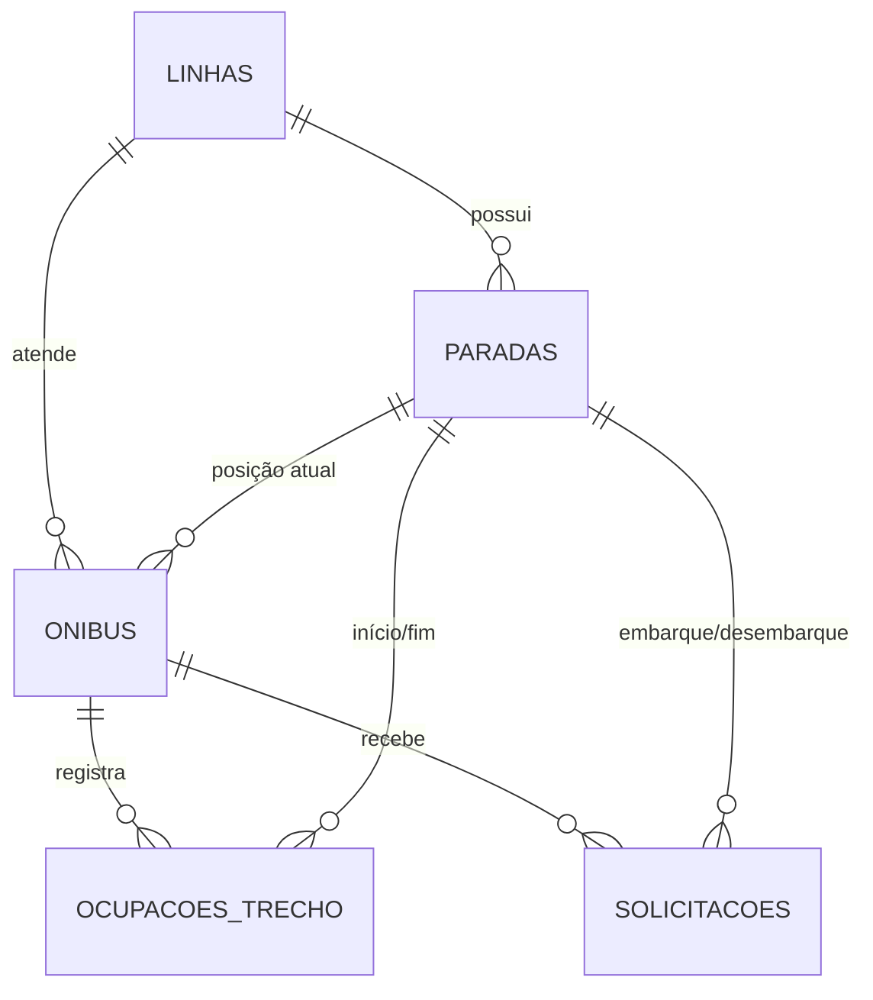

# Persistência do projeto

Este documento descreve o banco e o mapeamento de persistência atualmente configurados no módulo `demo`.

## Tecnologias e responsabilidades

- **H2** é o banco relacional embutido usado pela aplicação. Na configuração normal, ele grava em arquivo, então os dados permanecem após encerrar e iniciar a aplicação novamente. Não é necessário instalar ou executar um servidor de banco separado.
- **Spring Data JPA** fornece a integração entre a aplicação e repositórios Java. A dependência `spring-boot-starter-data-jpa` também traz o provedor JPA Hibernate.
- **JPA** define o mapeamento entre as classes anotadas com `@Entity` e as tabelas relacionais. Cada classe de entidade representa uma tabela; atributos e associações representam colunas.
- **Hibernate** implementa o mapeamento JPA e, com a configuração atual, cria ou atualiza o esquema na inicialização.
- **Repositórios** são interfaces que estendem `JpaRepository`. O Spring implementa operações comuns de consulta, gravação e remoção, e deriva algumas consultas do nome dos métodos.

Os modelos de domínio imutáveis do pacote `model` são separados das entidades de persistência do pacote `persistence.entity`. Essa separação permite que o formato usado para guardar dados não determine diretamente o formato das regras de negócio.

## Configuração

As dependências de banco e acesso a dados estão em [`demo/pom.xml`](./demo/pom.xml). As propriedades estão em [`demo/src/main/resources/application.properties`](./demo/src/main/resources/application.properties):

| Propriedade | Valor/efeito |
|---|---|
| `spring.datasource.url` | `jdbc:h2:file:./data/transporte`: banco H2 em arquivo. O caminho é relativo ao diretório de trabalho do processo. |
| `spring.datasource.username` | `sa`, usuário local padrão configurado para a conexão. |
| `spring.datasource.password` | Vazia na configuração de desenvolvimento. |
| `spring.jpa.hibernate.ddl-auto` | `update`: Hibernate cria ou ajusta tabelas para corresponder às entidades mapeadas. |
| `spring.jpa.open-in-view` | `false`: não mantém a sessão JPA aberta durante toda a resposta web. |

Ao iniciar a aplicação com o diretório de trabalho `demo`, o arquivo do banco fica em `demo/data/transporte.mv.db`. Essa pasta é ignorada pelo Git e não deve ser apagada se os dados locais precisarem ser preservados.

`ddl-auto=update` é conveniente durante o desenvolvimento, mas não substitui migrações versionadas de esquema. Não há migrações nem carga automática de dados de demonstração configuradas neste momento.

## Relações entre as tabelas

Uma linha possui paradas em uma ordem definida e pode ter ônibus associados. Cada ônibus referencia a linha atendida e uma parada para indicar sua posição atual. As ocupações representam a lotação de trechos para um ônibus específico. Uma solicitação referencia o ônibus escolhido e suas paradas de embarque e desembarque.

As relações JPA usam `ManyToOne`: cada linha, ônibus ou parada referenciada pode estar associada a vários registros do outro lado. No banco, essas associações são armazenadas como colunas de chave estrangeira. As entidades não definem coleções de relacionamentos inversos.

## Tabelas e colunas

Os nomes abaixo são os nomes configurados nas entidades. Tipos SQL exatos podem variar conforme o Hibernate e a versão do H2; a tabela indica os tipos Java mapeados. Os identificadores são UUIDs e as colunas de relacionamento guardam o UUID da entidade referenciada.

### `linhas`

Mapeada por `LinhaEntity`.

| Coluna | Tipo Java | Regras e significado |
|---|---|---|
| `id` | `UUID` | Chave primária da linha. |
| `nome` | `String` | Obrigatório (`NOT NULL`); nome da linha. |

### `paradas`

Mapeada por `ParadaEntity`.

| Coluna | Tipo Java | Regras e significado |
|---|---|---|
| `id` | `UUID` | Chave primária da parada. |
| `linha_id` | `UUID` | Obrigatório; chave estrangeira para `linhas.id`. |
| `numero` | `int` | Número apresentado para identificar a parada. A entidade não define validação de positividade. |
| `ordem` | `int` | Posição da parada no percurso. A entidade não define validação de positividade. |

Há uma restrição única em (`linha_id`, `ordem`), para que uma linha não tenha duas paradas na mesma posição.

### `onibus`

Mapeada por `OnibusEntity`.

| Coluna | Tipo Java | Regras e significado |
|---|---|---|
| `id` | `UUID` | Chave primária do ônibus. |
| `linha_id` | `UUID` | Obrigatório; chave estrangeira para `linhas.id`. |
| `capacidade` | `int` | Capacidade máxima do ônibus. A entidade não define validação de positividade. |
| `horario_saida` | `LocalTime` | Obrigatório; horário de saída. |
| `estado` | `EstadoOnibus` | Obrigatório; enum gravado como texto (`EnumType.STRING`), por exemplo `EM_TRANSITO` ou `ESTACIONADO`. |
| `parada_atual_id` | `UUID` | Obrigatório; chave estrangeira para `paradas.id`, que identifica a posição atual. |

### `ocupacoes_trecho`

Mapeada por `OcupacaoTrechoEntity`. Cada registro representa a ocupação de um trecho de um ônibus.

| Coluna | Tipo Java | Regras e significado |
|---|---|---|
| `id` | `UUID` | Chave primária do registro de ocupação. |
| `onibus_id` | `UUID` | Obrigatório; chave estrangeira para `onibus.id`. |
| `parada_inicial_id` | `UUID` | Obrigatório; chave estrangeira para `paradas.id`, parada inicial do trecho. |
| `parada_final_id` | `UUID` | Obrigatório; chave estrangeira para `paradas.id`, parada final do trecho. |
| `passageiros` | `int` | Obrigatório; quantidade de passageiros naquele trecho. |

Há uma restrição única em (`onibus_id`, `parada_inicial_id`, `parada_final_id`), evitando dois registros para o mesmo trecho do mesmo ônibus.

### `solicitacoes`

Mapeada por `SolicitacaoEntity`.

| Coluna | Tipo Java | Regras e significado |
|---|---|---|
| `id` | `UUID` | Chave primária da solicitação. |
| `onibus_id` | `UUID` | Obrigatório; chave estrangeira para `onibus.id`. |
| `parada_embarque_id` | `UUID` | Obrigatório; chave estrangeira para `paradas.id`, parada de embarque. |
| `parada_desembarque_id` | `UUID` | Obrigatório; chave estrangeira para `paradas.id`, parada de desembarque. |

O modelo atual não inclui data de criação, estado da solicitação nem uma associação direta entre a solicitação e os registros de ocupação atualizados.

## Repositórios disponíveis

| Repositório | Operações específicas |
|---|---|
| `LinhaRepository` | Operações padrão de `JpaRepository`, incluindo buscar por UUID e listar linhas. |
| `ParadaRepository` | `findByLinha_IdOrderByOrdemAsc(UUID linhaId)` busca as paradas de uma linha ordenadas pelo percurso. |
| `OnibusRepository` | `findByLinha_Id(UUID linhaId)` busca ônibus associados a uma linha. |
| `OcupacaoTrechoRepository` | `findByOnibus_Id(UUID onibusId)` busca ocupações registradas para um ônibus. |
| `SolicitacaoRepository` | Operações padrão de `JpaRepository` para solicitações. |

Esses repositórios oferecem acesso a dados, mas ainda não formam, por si sós, operações de negócio para cadastrar linhas, registrar solicitações ou atualizar ocupações.

## Limites atuais do esquema

As chaves estrangeiras, colunas obrigatórias e restrições únicas descritas acima são aplicadas pelo mapeamento JPA/Hibernate. Algumas regras de negócio ainda não estão expressas como restrições do banco nem como um fluxo de serviço:

- Limitar a quantidade total de linhas a três.
- Garantir que a capacidade e o número/ordem de parada sejam positivos no banco.
- Garantir que as paradas de um ônibus, trecho ou solicitação pertençam à linha do ônibus referenciado.
- Garantir que a parada final venha depois da inicial no percurso.
- Impedir que `passageiros` fique negativo ou acima da capacidade do ônibus.
- Atualizar ocupações e gravar uma solicitação atomicamente, incluindo controle de concorrência.

Esses comportamentos pertencem a tarefas posteriores do backlog; a existência das tabelas não significa que essas validações ou operações já estejam implementadas.
